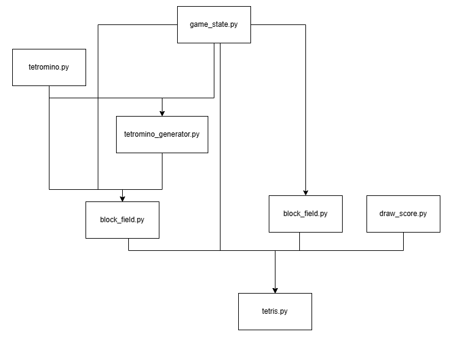

## Architecture

The functions that run the game are contained within the **tetris.py** module, and a majority of modules are directly referenced within it. The only exceptions to this are the modules tied to individual game pieces, which are referenced inside of **block_field.py**. The block_field module contains a class that defines the game board as a whole.

An overview of every module & how they reference each other:

## Modules & Functions

**tetris.py** contains the Tetris class which contains a update(), draw() and handle_events() function which run the game by updating the the game, drawing to the screen and handling events in regular intervals making pieces fall downwards. They directly reference **block_field.py**, **movement.py**, **game_state.py** and **draw_score.py**.

**game_state.py** is where the current state of the game is stored, using classes for "Timer" (determining game speed) & "Score".

**draw_score.py** generates a picture showing the next game piece to be generated using the "draw_array" function

**movement.py** handles the movement of individual game pieces primarily using the "movement" function. It directly references **game_state.py**

**block_field.py** handles changes to the game board as a whole using the "BlockField" class. It directly references **game_state.py**, **tetromino.py** and **tetromino_generator.py**

**tetromino.py** defines the shape of individual game pieces, called "tetrominos", using a "Tetromino" abstract class and individual classes for every possible shape.

**tetromino_generator.py** creates new game pieces with a random shape and color using the "TetrominoGenerator" class. It directly references **tetromino.py** and **game_state.py**

**HighScore.txt** is a text file containing the 10 highest scores achieved within a copy of the game. This file is automatically generated with 10 scores of 0 upon starting the game for the first time.

## dependencies:
* python >=3.14
* pygame-ce>=2.5.6
* ctypes
* os
* numpy>=2.4.1
* typing
* sys
* random